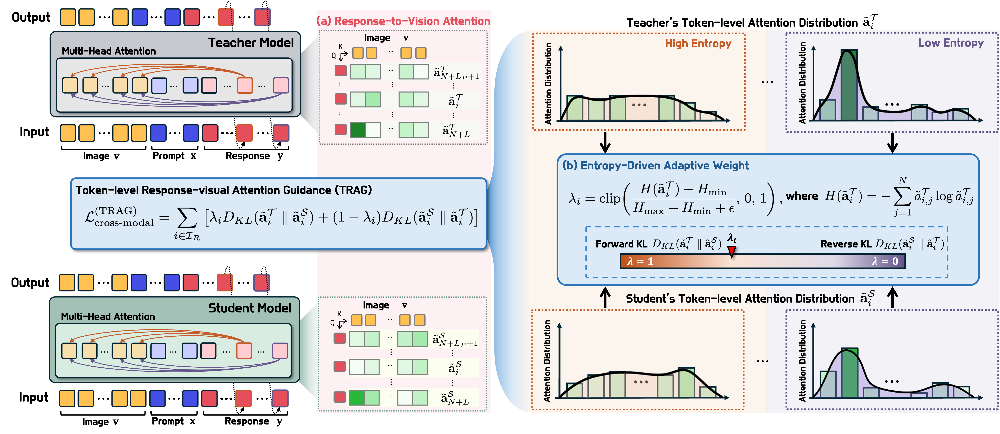

# 🌟 TRAG: Token-level Response-visual Attention Guidance for Multimodal LLMs Knowledge Distillation
<p align="center">
  <b>ECCV 2026</b>
</p>

<p align="center">
  <a href="https://arxiv.org/abs/2607.02593">
    
  </a>
  <a href="#-citation">
    
  </a>
</p>

## 📢 News

- **[2026.11]** Training and evaluation code released.
- **[2026.06]** TRAG was accepted to **ECCV 2026**.

## 📌 Overview

This is the official implementation of:

**Token-level Response-visual Attention Guidance for Multimodal LLMs Knowledge Distillation**

TRAG is a knowledge distillation framework for Multimodal Large Language Models (MLLMs).
It guides a compact student by supervising **Response-to-Vision attention**, which reflects
how visual evidence is used while each response token is generated, rather than relying only
on output token distributions.

## 🔍 Key Idea

TRAG is built around two observations:

1. **Response-to-Vision attention is more informative than Prompt-to-Vision attention.**
   Visual grounding during response generation is closely related to downstream performance.

2. **Different response tokens require different visual grounding behavior.**
   Some tokens attend broadly to the scene, while others require localized visual evidence.

## 🧠 Method Highlights

- 🖼️ **Response-to-Vision Attention Guidance**: supervises attention from response tokens to
  visual tokens, averaged over intermediate decoder layers (relative depth 0.3–0.6) and
  renormalized on the visual tokens.
- 🔎 **Token-level Distillation**: each response token is guided separately.
- ⚖️ **Entropy-aware Adaptive KL**: forward and reverse KL are mixed per token according to the
  teacher's attention entropy, using running min/max entropy bounds (EMA, β = 0.995).
- 📉 **Compact MLLM Distillation**: combined with language modeling, response-logit KL, and
  LLaVA-KD vision-token distillation in a DPT → SFT → DFT schedule.

## 🖼️ Method Overview

<p align="center">
  
</p>

<p align="center">
  <i>Overview of Token-level Response-visual Attention Guidance.</i>
</p>

## ⚙️ Installation

The experiments use Python 3.10, PyTorch 2.0.1, Transformers 4.40.1, FlashAttention 2.5.7,
and DeepSpeed 0.14.0.

```bash
git clone https://github.com/jhjangjh/TRAG.git
cd TRAG
conda env create -f environment.yml
conda activate trag
PIP_CACHE_DIR=/tmp/trag-pip-cache pip install --no-build-isolation -r requirements/flash-attn.txt
```

`environment.yml` installs `requirements.txt`, which covers training, evaluation, and tests.
FlashAttention must be installed after PyTorch and needs a compatible prebuilt wheel or a CUDA
toolkit with `nvcc`. Its installer moves the downloaded wheel from the temporary directory into
the pip cache with a rename, so both must be on the same filesystem; the command above keeps the
cache under `/tmp` (adjust it if `TMPDIR` points elsewhere). Optional extras: `pip install -e '.[quantization]'`, `'.[serve]'`, or
`'.[wandb]'`.

Check the environment with:

```bash
pip check
python -m pytest tests
python -c "import torch, flash_attn; print(torch.__version__, flash_attn.__version__)"
```

## 📂 Data and Models

Datasets and model weights are not redistributed. Download them from their original providers:

```text
data/
├── LLaVA-Pretrain/
│   ├── blip_laion_cc_sbu_558k.json
│   └── images/
└── LLaVA-Finetune/
    ├── llava_v1_5_mix665k.json
    └── ... image folders referenced by the JSON file
```

- **DPT**: LLaVA-Pretrain-558K. **SFT / DFT**: LLaVA-Instruct-665K.
- **Vision encoder**: `google/siglip-so400m-patch14-384` (frozen; 729 visual tokens).
- **Teacher**: a TinyLLaVA-format MLLM (Qwen1.5 / Qwen2.5 LLMs in the paper) that uses the same
  vision encoder and a tokenizer vocabulary compatible with the student.
- **Student LLM**: a Hugging Face model path or ID. The name must contain the model family
  (e.g. `qwen`) so that the LLM can be registered.

Copy the path template and fill in your local settings:

```bash
cp configs/paths.example.env configs/paths.env
$EDITOR configs/paths.env
```

## 🚀 Training

Run the three-stage DPT → SFT → DFT schedule:

```bash
bash scripts/train_trag.sh configs/paths.env
```

| Stage | Data | Trained modules | Objective | LR | Global batch |
| --- | --- | --- | --- | --- | --- |
| DPT | LLaVA-Pretrain-558K | projector | LM + uni-modal KD + TRAG | 1e-3 | 256 |
| SFT | LLaVA-Instruct-665K | projector + LLM | LM | 2e-5 | 128 |
| DFT | LLaVA-Instruct-665K | projector + LLM | LM + uni-modal KD + TRAG | 2e-5 | 128 |

All stages train for one epoch with AdamW (β = 0.9, 0.99), a cosine schedule with 0.03 warm-up,
no weight decay, BF16, and DeepSpeed ZeRO-2. The default per-device batch sizes in
`configs/paths.example.env` assume **two GPUs**; adjust them so that the global batch sizes above
are preserved. With a 0.5B student and a 3B teacher, the defaults peak at about 35 GB per GPU on
the longest samples. DPT saves `language_model/`, `vision_tower/`, and `connector/`; SFT and DFT
save a single `model.safetensors`, which the next stage and the evaluation scripts load.

Code layout:

- `tinyllava/train/trag.py`: the TRAG objective (layer aggregation, entropy weighting, adaptive KL).
- `tinyllava/train/distill_trainer.py`: FlashAttention-compatible attention extraction from Q/K
  projections and the complete distillation loss.
- `tinyllava/model/modeling_tinyllava_distill.py`: multimodal model wrapper that exposes the
  visual-token spans used for distillation.
- `tests/`: CPU tests for the objective, attention extraction, and every distillation mode.

Implementation notes:

- Attention is averaged over heads and over the intermediate layers, then renormalized on the
  visual tokens. Response tokens are the supervised (label ≠ −100) positions after the image.
- All loss terms are token means, and per-sample terms are averaged over samples that contain
  an image, following LLaVA-KD.
- Entropy bounds are rank-local and updated once per forward mini-batch after the loss is built.
  They are not checkpointed: `--resume_from_checkpoint` restores the model, optimizer, and
  scheduler, and the entropy statistics restart from the warm-up.
- `--distill_mode` also accepts `kd`, `llava-kd`, and `compodistill` for the comparison
  objectives. Please cite LLaVA-KD and CompoDistill when using them.

## 📊 Evaluation

Evaluation follows the LLaVA-1.5 protocol. Prepare the evaluation data in the
[LLaVA-1.5 layout](https://github.com/haotian-liu/LLaVA/blob/main/docs/Evaluation.md) and point
`EVAL_DIR` to it, then run one script per benchmark (the optional second argument is a GPU list):

```bash
export EVAL_DIR=/path/to/eval
bash scripts/eval/gqa.sh /path/to/model 0,1,2,3   # GQA (uses gqa/eval.py from the LLaVA-1.5 data)
bash scripts/eval/sqa.sh /path/to/model           # ScienceQA-IMG (reports IMG-Accuracy)
bash scripts/eval/textvqa.sh /path/to/model       # TextVQA
bash scripts/eval/mme.sh /path/to/model           # MME (uses MME/eval_tool from the LLaVA-1.5 data)
bash scripts/eval/pope.sh /path/to/model          # POPE (reports the F1 averaged over 3 categories)
bash scripts/eval/mmbench.sh /path/to/model       # MMBench; LANG_SPLIT=cn for MMBench-CN
MMMU_EVAL_DIR=/path/to/MMMU/mmmu bash scripts/eval/mmmu.sh /path/to/model  # MMMU
bash scripts/eval/cr.sh /path/to/model            # SugarCrepe, BiVLC, Winoground
```

MMBench and MMBench-CN write an `.xlsx` file to upload to the official evaluation server. MMMU is
scored with `main_eval_only.py` from the [MMMU repository](https://github.com/MMMU-Benchmark/MMMU).
All scripts use `--conv-mode qwen2_base` (override with `CONV_MODE`) and greedy decoding.

**Compositional reasoning** (SugarCrepe, BiVLC, Winoground) uses a two-caption multiple-choice
prompt. Each example is evaluated twice with the caption order swapped to control for positional
bias; a response is correct only if it selects the positive caption. A response selects a caption
when it states its index (e.g. `(2)`), reproduces exactly one caption (ignoring case and
punctuation), or answers `A`/`B`; any other response, including an empty one, is scored as
incorrect (`tinyllava/eval/choice_parsing.py`). The reported accuracy is the mean over both orders
(and, for SugarCrepe, over its seven splits). `scripts/eval/cr.sh` expects
`SugarCrepe/sugar-crepe/data` (the seven split files) with COCO `SugarCrepe/val2017`,
`BiVLC/data/*.parquet`, and `Winoground/data/{examples.jsonl,images}`.

## 🙏 Acknowledgements and License

This implementation is built on [TinyLLaVA Factory](https://github.com/TinyLLaVA/TinyLLaVA_Factory)
and includes comparison objectives based on LLaVA-KD and CompoDistill. See [`NOTICE`](NOTICE).
The code is released under the Apache License 2.0; licenses of the models and datasets apply
separately.

## 📖 Citation

If you find this work useful, please consider citing:

```bibtex
@article{jang2026trag,
  title={Token-level Response-visual Attention Guidance for Multimodal LLMs Knowledge Distillation},
  author={Jang, Jaehyun and Yoon, Eunseop and Yoon, Hee Suk and Eom, SooHwan and Hasegawa-Johnson, Mark A. and Yoo, Chang D.},
  journal={arXiv preprint arXiv:2607.02593},
  year={2026}
}
```

## 📬 Contact

For questions, please contact: [jhjangjh@kaist.ac.kr](mailto:jhjangjh@kaist.ac.kr)
